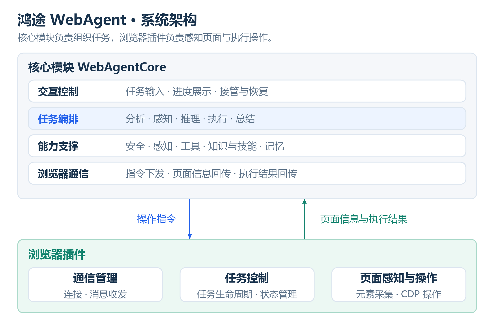
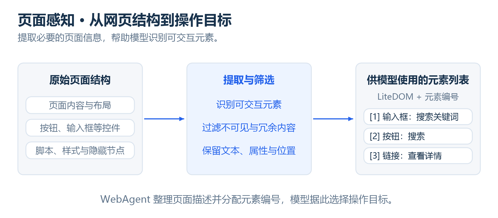
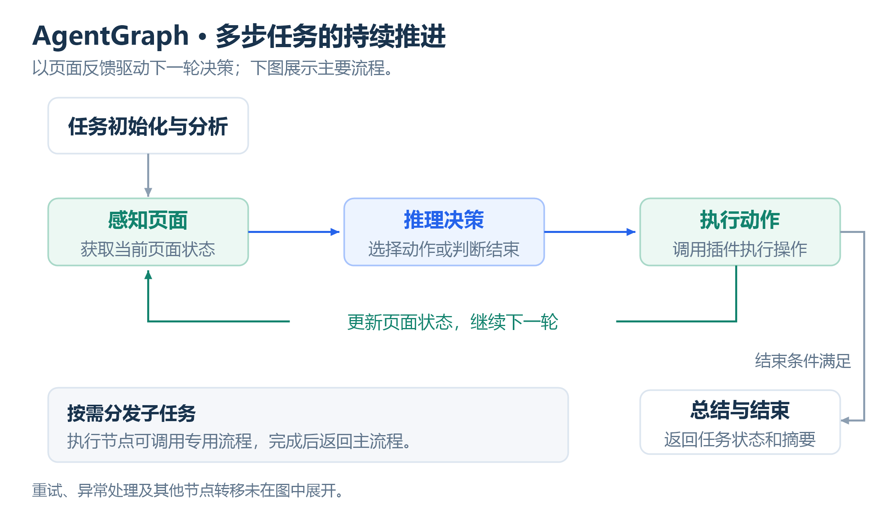
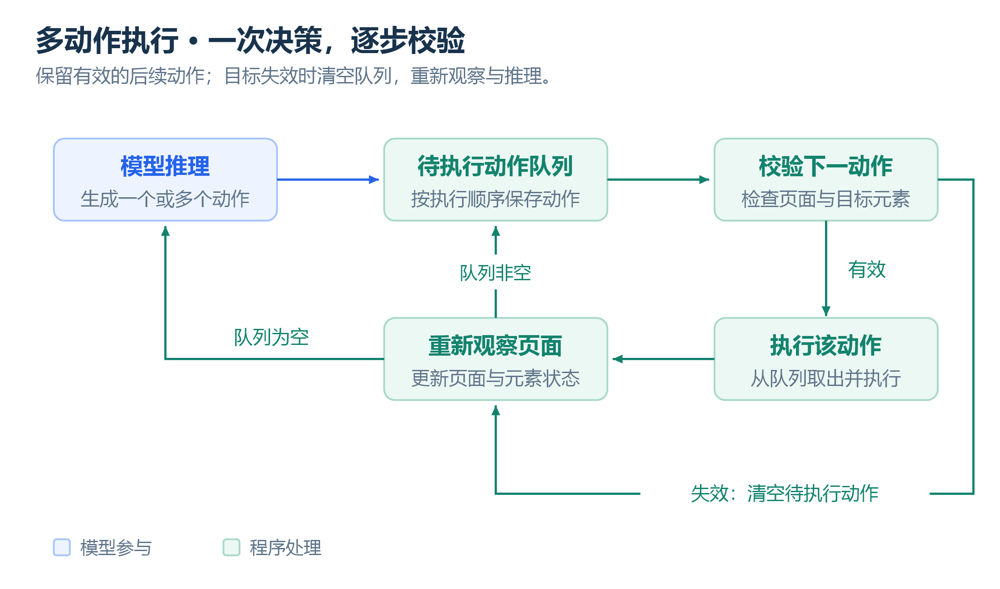
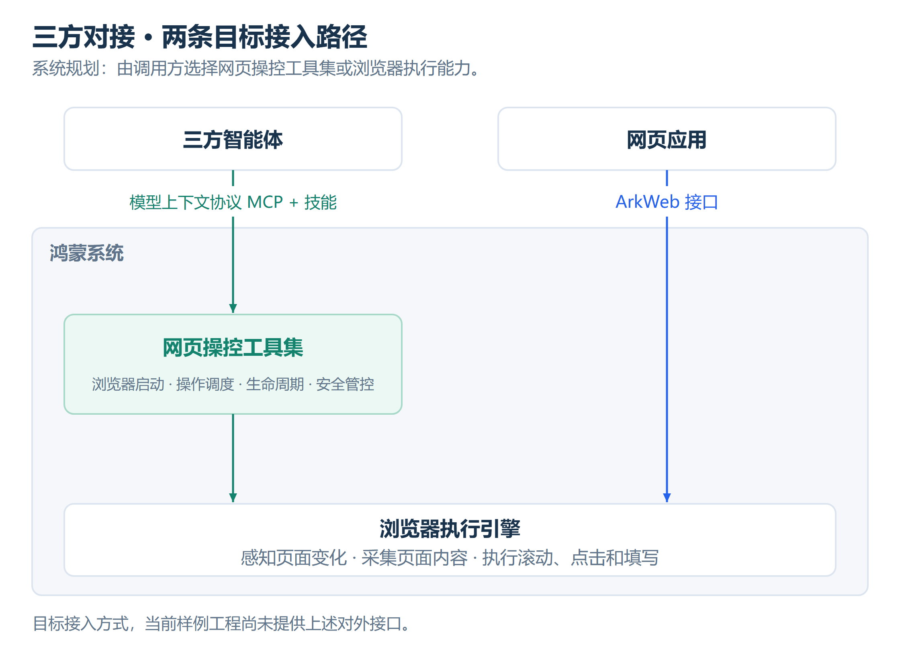
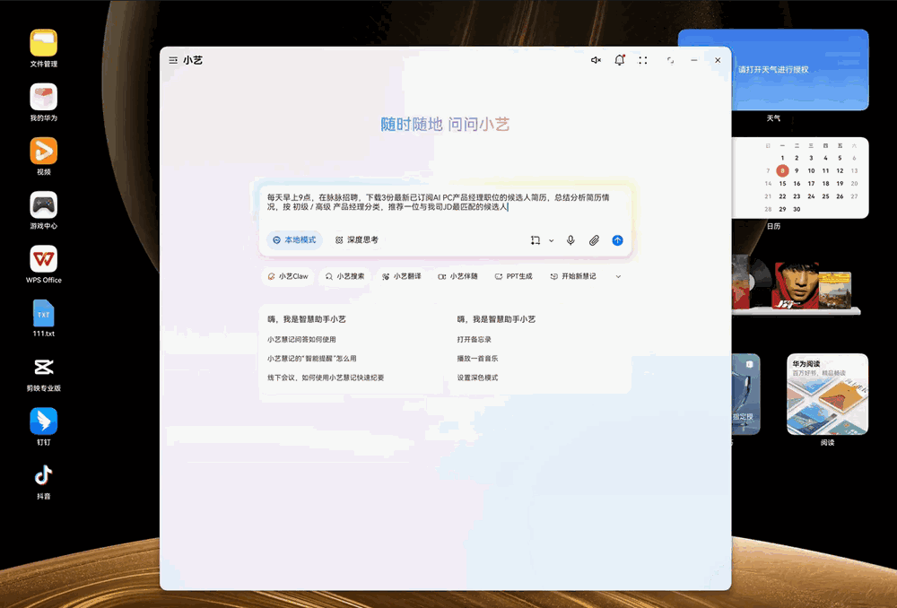

# 鸿途 WebAgent

鸿途 WebAgent 面向自然语言驱动的网页任务，旨在减少用户在浏览器中反复查找、输入和切换页面的操作，提升网页私域信息收集和自动化表单填写的效率。鸿途 WebAgent提供可集成的任务执行能力，使用户能够直接表达目标，由智能体组织后续操作并反馈结果。本文介绍项目的架构设计、组件分工、核心特性与评测结果。

> **使用前提：** 本仓库的 WebAgent 样例仅包含 Agent 侧代码，需与浏览器插件配合才能采集页面信息、执行动作，单独运行无法完成网页任务。
## 目录

- [什么是鸿途 WebAgent](#什么是鸿途-webagent)
- [核心组件详解](#核心组件详解)
- [核心特性](#核心特性)
- [一次任务的数据流](#一次任务的数据流)
- [三方对接](#三方对接)
- [性能与对比](#性能与对比)
- [总结](#总结)
- [示例](#示例)

## 什么是鸿途 WebAgent

鸿途 WebAgent 是面向浏览器应用的网页任务智能体（Agent），主要由核心模块（WebAgentCore）和浏览器插件两部分组成。WebAgentCore 负责组织页面观察、调用模型并管理任务状态，浏览器插件负责页面信息采集与动作执行。任务结束后，WebAgentCore 向调用方返回运行状态和结果摘要。

网页任务执行过程中，页面跳转、异步加载、弹窗和控件位置变化都可能影响后续操作。为适应这些变化，WebAgent 采用 **观察 → 推理 → 执行 → 再观察** 的闭环。以“在当前网站搜索并整理结果”为例，插件首先返回页面信息和可交互元素，模型据此选择输入或点击动作；插件执行后，WebAgent 根据更新后的页面判断目标是否达成，并决定是否继续执行。

从架构设计看，WebAgentCore 由交互控制、任务编排、能力支撑和浏览器通信四个层次组成。交互控制层负责展示页面与任务状态，并提供任务询问、接管恢复和安全告警等交互。任务编排层（Agent Graph）组织分析、感知、推理、执行与总结等环节，根据页面反馈调整执行流程，并为特定任务调用专用流程。

能力支撑层为任务编排提供安全、感知、工具、知识与技能，以及记忆能力。感知模块采集可交互元素、截图和标签页信息，工具模块封装并组织原子动作。知识与技能模块按通用操作、任务类别和具体站点组织执行方法，记忆模块保存任务上下文与历史经验。安全模块则围绕提示注入、敏感操作和输出内容设置检查点。

底层的浏览器通信层（Browser Transport）连接 WebAgentCore 与浏览器插件，传递操作指令、页面信息和执行结果。插件接收指令后，通过浏览器调试协议调用浏览器能力，完成点击、输入和滚动等页面操作，再将执行结果和更新后的页面状态返回 WebAgentCore。WebAgentCore 据此判断任务进展并调整后续步骤，使模型决策与实际网页操作形成闭环。

## 核心组件详解

### 应用入口与运行生命周期

 [`BrowserAgentPage`](sample/electron/src/main/ets/pages/BrowserAgentPage.ets) 提供任务输入、文本或视觉模式选择，以及进度和结果展示功能。对外入口 [`BrowserAutomationFacadeService`](sample/electron/src/main/ets/core/features/browser/host/BrowserAutomationFacadeService.ets) 接收任务、会话信息、回调和运行选项，并返回运行结果（`BrowserRuntimeState`）；同时提供任务停止与插件连接状态查询功能。

运行宿主 [`BrowserExecutionHostService`](sample/electron/src/main/ets/core/features/browser/execution/BrowserExecutionHostService.ets) 负责启动通信、等待插件连接并准备任务上下文。任务执行器 [`BrowserAgentRunner`](sample/electron/src/main/ets/core/features/browser/agent/runner/Runner.ets) 随后准备运行依赖、执行任务图，并将最终状态返回给运行宿主。

### 任务编排、页面观察与推理

任务编排器（AgentGraph）的节点与转移规则定义在 [`Graph.ts`](sample/electron/src/main/ets/core/features/browser/agent/graph/Graph.ts) 中，包含感知（`perceive`）、分析（`analyse`）、推理（`reason`）、执行（`execute`）、分发（`dispatch`）和总结（`conclude`）六类节点。[`AgentState`](sample/electron/src/main/ets/core/features/browser/agent/core/AgentState.ts) 保存任务信息、观察结果和待执行动作，为各节点提供共享状态。

[`ObservationService`](sample/electron/src/main/ets/core/features/browser/agent/core/ObservationService.ts) 将插件返回的精简页面结构（LiteDOM）、页面信息和截图整理为模型可读的观察结果。[`ReasoningService`](sample/electron/src/main/ets/core/features/browser/agent/core/ReasoningService.ts) 根据当前任务状态构造纯文本或带截图的请求，再由调用方提供的模型服务处理。

### 动作执行与浏览器通信

[`MultiStepActionService`](sample/electron/src/main/ets/core/features/browser/agent/core/MultiStepActionService.ts) 校验连续动作是否仍适用于当前页面，[`BrowserEnvironmentAdapter`](sample/electron/src/main/ets/core/features/browser/agent/adapters/BrowserEnvironmentAdapter.ets) 则将动作转换为浏览器命令。

浏览器通信层（Transport）通过 [`BrowserTransportHostService`](sample/electron/src/main/ets/core/features/browser/transport/BrowserTransportHostService.ets) 管理请求与响应，由 [`BrowserTransportServerService`](sample/electron/src/main/ets/core/features/browser/transport/BrowserTransportServerService.ets) 提供调试构建中的本机 WebSocket 通道。

浏览器插件负责页面感知、控件定位和动作执行。修改消息格式或动作语义时，开发者需要同步核对核心模块与插件的实现。详细流程见[动作执行链路](sample/electron/src/main/ets/docs/readme/action-execution-pipeline.md)。

## 核心特性

### 页面观察：为动作决策提供页面状态

插件返回 LiteDOM、页面地址、标题和截图等信息。LiteDOM 包含可交互元素的文本、属性、定位信息和所在区域。WebAgent 将这些信息整理为模型可读的页面描述，并为可交互元素分配编号，供模型选择操作目标。网页出现原生对话框时，WebAgent 会改为向模型提供对话框信息。

上图展示从页面结构到模型操作目标的整理过程：浏览器插件负责提取与筛选页面信息，WebAgent 负责整理页面描述并分配元素编号。

页面观察结果同时用于模型推理和动作校验。WebAgent 通过比较动作前后的页面状态与目标元素，判断后续动作是否仍然有效。当前默认配置还会生成 LiteDOM 变化摘要，帮助模型在下一轮推理中关注页面变化。

### AgentGraph：在页面变化中推进任务

模型负责判断目标是否达成并选择下一步动作，AgentGraph 负责节点流转、重试、子任务分发和结束状态管理。动作执行后，流程返回感知节点，使后续决策基于更新后的页面状态。

上图保留任务初始化、分析、感知、推理、执行和总结等主要环节，并标出按需分发子任务的能力。重试、异常处理及其他节点转移未在图中展开，具体规则以源码为准。

[`VersionConfig.ts`](sample/electron/src/main/ets/core/features/browser/agent/VersionConfig.ts) 管理推理和观察策略。当前默认配置版本 `11.7` 启用两阶段推理：WebAgent 首先基于文本信息进行判断，在文本信息不足、模型请求截图或需要视觉核对时，再引入截图。评测时应同时记录配置版本、模型和观察模式，以明确结果的适用条件。

### 多动作执行：连续操作与逐步校验

模型可在一次推理中生成当前动作和后续的待执行动作队列（`actionQueue`）。WebAgent 核心模块按顺序下发动作，并在每步执行后重新观察页面。校验范围包括页面地址、站点，以及目标元素的定位路径（XPath）、文本、属性、位置和遮挡情况。当目标失效时，核心模块停止执行队列，并将更新后的状态交给推理服务。

图中蓝色节点表示模型推理，绿色节点表示程序处理。动作执行后，WebAgent 重新观察页面；队列非空时继续校验下一动作，队列为空或目标失效时重新推理。具体校验条件以源码为准。

这一机制允许多个动作复用一次模型决策，同时在页面跳转或控件变化后重新判断后续动作的有效性。实际页面操作由浏览器插件完成。

## 一次任务的数据流

1. **接收任务**：调用方提交任务目标和模型回调，运行宿主创建任务状态并等待插件连接。
2. **准备执行**：任务执行器准备浏览器环境和模型适配，并确定起始页面。
3. **观察页面**：插件返回 LiteDOM、页面信息和可用截图，WebAgent 将这些信息整理为模型可读的页面描述。
4. **决定动作**：任务图和推理服务组织模型请求，由模型选择动作；信息不足时，WebAgent 可补充截图。
5. **执行和复查**：通信层将动作发送至插件。动作执行后，核心模块重新观察页面并校验待执行队列，再决定继续执行、重新推理或结束任务。
6. **形成结果**：任务执行器将最终状态返回运行宿主，调用方据此展示运行状态和结果摘要。

任务执行可能受到模型回调缺失、插件连接超时、模型决策失败或页面目标失效等因素影响。运行状态和执行记录可用于定位问题发生的阶段及原因。

## 三方对接

下图展示面向三方智能体和网页应用的**目标接入方式**。这些路径属于系统规划，当前样例工程尚未提供相应的对外接口。

图中，MCP 表示模型上下文协议，技能与网页操控工具集提供浏览器操作能力，ArkWeb 表示网页引擎。

<table align="center" style="display: table; margin-left: auto; margin-right: auto;">
  <thead><tr><th align="center" valign="middle" style="text-align: center; vertical-align: middle;">调用方</th><th align="center" valign="middle" style="text-align: center; vertical-align: middle;">目标接入路径</th><th align="center" valign="middle" style="text-align: center; vertical-align: middle;">职责分工</th></tr></thead>
  <tbody>
    <tr><td align="center" valign="middle" style="text-align: center; vertical-align: middle;">三方智能体</td><td align="center" valign="middle" style="text-align: center; vertical-align: middle;">通过 MCP 与技能调用网页操控工具集</td><td align="center" valign="middle" style="text-align: center; vertical-align: middle;">三方智能体负责推理，工具集负责浏览器启动、操作调度、生命周期管理与安全管控</td></tr>
    <tr><td align="center" valign="middle" style="text-align: center; vertical-align: middle;">网页应用</td><td align="center" valign="middle" style="text-align: center; vertical-align: middle;">通过 ArkWeb 接口调用网页操控执行引擎</td><td align="center" valign="middle" style="text-align: center; vertical-align: middle;">执行引擎感知页面变化、采集内容，并执行滚动、点击和填写等操作</td></tr>
  </tbody>
</table>

当前仓库提供样例应用、WebAgent 核心模块的任务编排实现，以及与插件的通信实现。实现图中的接入路径时，仍需明确接口定义、权限要求与协议兼容方案，并完成调用端和执行端的适配。

## 性能与对比

本次评测采用 101 个测试用例，覆盖 20 余个网站的高频场景。对比方案包括鸿途 WebAgent、商用智能体 Manus、开源浏览器智能体 Browser Use 和智能体方案 openClaw。在统一使用视觉语言模型 Qwen 3.5 VL 397B 的条件下，鸿途 WebAgent 的通过率为 **80.5%**。表中同时列出其使用 DeepSeek-v4-flash + Qwen 3.6 27B 模型组合时的通过率结果。

<table align="center" style="display: table; margin-left: auto; margin-right: auto;">
  <thead><tr><th align="center" valign="middle" style="text-align: center; vertical-align: middle;">方案</th><th align="center" valign="middle" style="text-align: center; vertical-align: middle;">使用模型</th><th align="center" valign="middle" style="text-align: center; vertical-align: middle;">通过率</th></tr></thead>
  <tbody>
    <tr><td align="center" valign="middle" style="text-align: center; vertical-align: middle;"><strong>鸿途 WebAgent</strong></td><td align="center" valign="middle" style="text-align: center; vertical-align: middle;" rowspan="4">Qwen 3.5 VL 397B</td><td align="center" valign="middle" style="text-align: center; vertical-align: middle;"><strong>80.5%</strong></td></tr>
    <tr><td align="center" valign="middle" style="text-align: center; vertical-align: middle;">Manus</td><td align="center" valign="middle" style="text-align: center; vertical-align: middle;">75%</td></tr>
    <tr><td align="center" valign="middle" style="text-align: center; vertical-align: middle;">Browser Use</td><td align="center" valign="middle" style="text-align: center; vertical-align: middle;">62.5%</td></tr>
    <tr><td align="center" valign="middle" style="text-align: center; vertical-align: middle;">openClaw</td><td align="center" valign="middle" style="text-align: center; vertical-align: middle;">50%</td></tr>
    <tr><td align="center" valign="middle" style="text-align: center; vertical-align: middle;"><strong>鸿途 WebAgent</strong></td><td align="center" valign="middle" style="text-align: center; vertical-align: middle;">DeepSeek-v4-flash + Qwen 3.6 27B</td><td align="center" valign="middle" style="text-align: center; vertical-align: middle;"><strong>85.1%</strong></td></tr>
  </tbody>
</table>

在相同模型条件下，鸿途 WebAgent 的通过率相较于 Manus、Browser Use 和 openClaw 分别提升约 **7.3%**、**28.8%** 和 **61%**。相对提升率以各对比方案的通过率为基准计算，均对应 Qwen 3.5 VL 397B 模型组。

## 总结

鸿途 WebAgent 集成了结构化页面感知、文本与视觉协同、多步任务编排和连续动作校验等核心特性。它通过 LiteDOM 和页面变化摘要帮助模型识别操作目标，并在文本信息不足时引入截图，补充决策依据；通过 AgentGraph 管理任务状态、重试和子任务分发，支持多步任务的持续推进；同时支持一次推理生成多个动作，并在执行过程中逐步校验目标有效性，及时停止不再适用的动作，使后续决策能够适应页面变化。

## 示例

以下动图展示鸿途 WebAgent 执行网页任务的过程。

